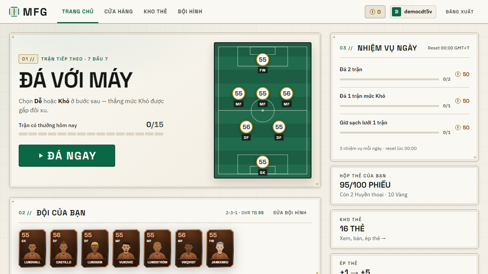
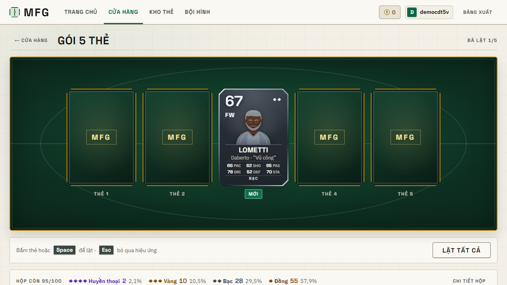
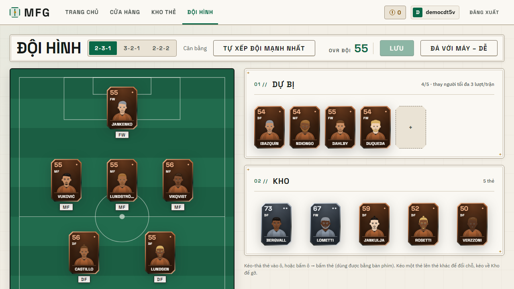
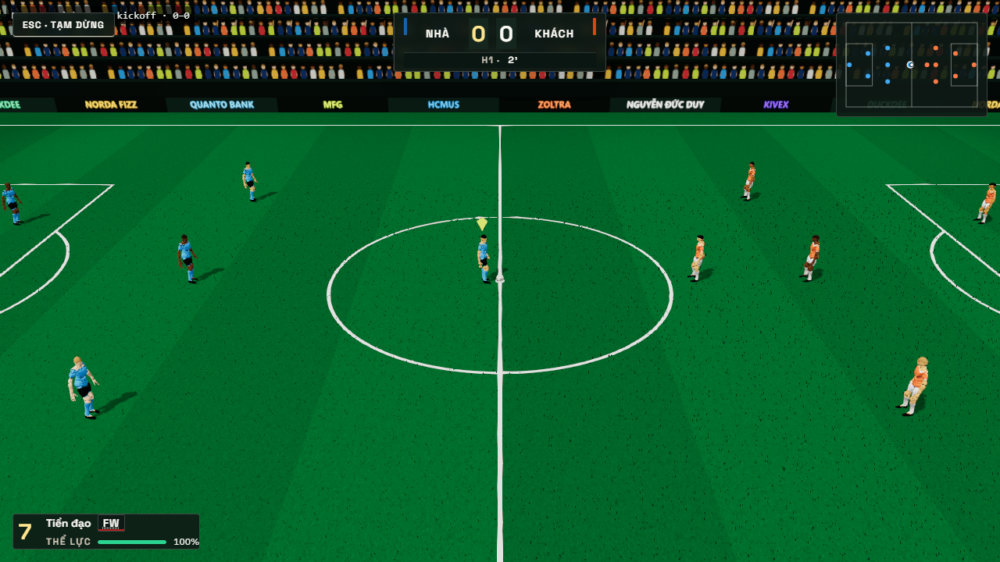

# MFG: My Football Game

Game bóng đá 7 người chơi trên trình duyệt: điều khiển cầu thủ trong trận 3D, mở gói thẻ cầu thủ, xây đội hình và ép thẻ. Đây là đồ án học tập.

- Cầu thủ, đội bóng và nhà tài trợ đều **hư cấu**. Không dùng tên, ảnh hay thương hiệu có thật.
- Xu và thẻ là **vật phẩm ảo**, chỉ kiếm được khi chơi. Game không có thanh toán bằng tiền thật.
- Server quyết định mọi thứ quan trọng: tỉ lệ ra thẻ, cộng trừ xu, thưởng sau trận. Client chỉ vẽ hình và nhận phím.

| Trang chủ | Mở gói thẻ |
|---|---|
|  |  |
| **Đội hình** | **Trận đấu** |
|  |  |

## Tính năng

- **Trận 7v7 với máy** ở 2 mức Dễ và Khó: chuyền, sút, chọc khe (giữ phím để nạp lực), thể lực, thay người, thẻ phạt, phạt đền, luân lưu. Điều khiển kiểu FC Online: mũi tên, S/A/D/W/Q/E, Esc.
- **Gói thẻ** dạng "hộp 100 phiếu": tỉ lệ ra thẻ công khai, rút không hoàn lại, có bảo đảm trong gói 5 thẻ.
- **Đội hình**: 3 sơ đồ, 7 người đá chính + 5 dự bị. Xếp sai vị trí bị trừ 15% chỉ số; ô GK chỉ nhận thủ môn.
- **Ép thẻ** +1 → +5, **nhiệm vụ ngày**, **quà tân thủ**, đăng nhập bằng mật khẩu hoặc Google.
- **Trang quản trị** xem số liệu giữ chân người chơi; **xoá tài khoản** và trang Chính sách bảo mật / Điều khoản sử dụng.

## Kiến trúc

Monorepo TypeScript (pnpm):

| Thư mục | Vai trò |
|---|---|
| `packages/sim` | Mô phỏng trận: vật lý, luật, AI. Thuần TypeScript, tất định theo seed, không phụ thuộc DOM hay Three.js |
| `packages/shared` | Kiểu dữ liệu, schema Zod cho API, công thức chỉ số dùng chung cho web và server |
| `apps/server` | Fastify + PostgreSQL (Drizzle). Phiên đăng nhập bằng cookie, mật khẩu băm argon2. Ví xu và hộp thẻ dùng transaction + `FOR UPDATE`; sổ cái xu chỉ cho ghi thêm |
| `apps/web` | React + Vite + TanStack Query; Three.js vẽ trận với camera kiểu truyền hình |

Chi tiết xem [docs/ARCHITECTURE.md](docs/ARCHITECTURE.md), các quyết định kỹ thuật ở [docs/adr/](docs/adr/), yêu cầu sản phẩm ở [docs/PRD.md](docs/PRD.md).

## Chạy trên máy (dev)

Cần **Node ≥ 24**, **pnpm 12** (bật bằng `corepack enable`) và **Docker** (để chạy Postgres 16).

```bash
git clone https://github.com/DucDuyNguyen15-IT/my-football-game.git
cd my-football-game
pnpm install
docker compose -f docker-compose.dev.yml up -d      # Postgres dev (DB pitch + pitch_test), chỉ nghe localhost
pnpm --filter @pitch/server db:migrate               # tạo bảng
pnpm --filter @pitch/server db:seed                  # nạp 150 thẻ cầu thủ
pnpm dev                                             # web http://localhost:5173, API :3000
```

Không có `.env` thì server dùng giá trị dev khớp `docker-compose.dev.yml`. Các biến môi trường khác (đăng nhập Google, …) xem [.env.example](.env.example).

**Model 3D:** file model không nằm trong repo (xem [Nguồn tài nguyên](#nguồn-tài-nguyên)); thiếu file thì game tự vẽ cầu thủ, bóng, khung thành bằng hình khối. Nếu có file gốc trong `assets-src/` thì chạy `pnpm assets` để dựng `apps/web/public/models/*.glb`.

## Kiểm thử

| Lệnh | Nội dung |
|---|---|
| `pnpm check` | ESLint + typecheck + toàn bộ test Vitest (gần 1.000 test; test server cần Postgres dev đang chạy) |
| `pnpm e2e` | Playwright chạy luồng chính: đăng ký → mở gói → xếp đội → đá trận → nhận thưởng → đăng nhập lại → xoá tài khoản. Lần đầu chạy `pnpm exec playwright install chromium` |

Báo cáo kiểm thử, bảo mật và hiệu năng: [docs/QA-REPORT.md](docs/QA-REPORT.md).

## Chạy bản production (Docker)

```bash
cp .env.example .env
# Sửa .env: SESSION_SECRET (≥ 32 ký tự ngẫu nhiên), POSTGRES_PASSWORD, APP_DB_PASSWORD (chỉ chữ + số,
# VD `openssl rand -hex 32`), SITE_ADDRESS = domain của bạn (bỏ trống = localhost)
docker compose up -d --build
```

Lệnh này dựng 4 dịch vụ:

- **Caddy**: HTTPS tự động, phục vụ web tĩnh, chuyển `/api` vào server, đặt header bảo mật.
- **migrate**: chạy migration và nạp thẻ bằng tài khoản chủ DB, chạy xong thì thoát.
- **server**: chạy bằng tài khoản DB chỉ có quyền đọc/ghi dữ liệu.
- **Postgres**: không mở cổng ra ngoài.

Mở `https://localhost` (trình duyệt sẽ cảnh báo chứng chỉ nội bộ của Caddy) hoặc domain đã đặt. Trước khi cập nhật lên bản có migration mới, nhớ sao lưu: `docker compose exec postgres pg_dump -U pitch_owner pitch > backup.sql`.

## Tài liệu

- [docs/ROADMAP.md](docs/ROADMAP.md): các giai đoạn phát triển. Tiến độ ở [docs/PROGRESS.md](docs/PROGRESS.md)
- [docs/DESIGN.md](docs/DESIGN.md): thiết kế giao diện và điều khiển
- [CLAUDE.md](CLAUDE.md): quy ước cho agent AI tham gia phát triển

## Nguồn tài nguyên

| Tài nguyên | Tác giả / nguồn | Giấy phép |
|---|---|---|
| "Football" (bóng) | BSlegt, Sketchfab | [CC BY 4.0](https://creativecommons.org/licenses/by/4.0/), đã chỉnh sửa (nén, chuẩn hoá toạ độ) |
| "Football Net" (khung thành) | Bryan Okafor - Ogu, Sketchfab | [CC BY 4.0](https://creativecommons.org/licenses/by/4.0/), đã chỉnh sửa (nén, chuẩn hoá toạ độ) |
| Nhân vật và hoạt ảnh cầu thủ | [Adobe Mixamo](https://www.mixamo.com/) | Miễn phí bản quyền, dùng được cho thương mại khi nhúng trong game; không được phân phối lại file gốc riêng lẻ, nên không đưa vào repo |

## Liên hệ

nguyenduycn06@gmail.com
